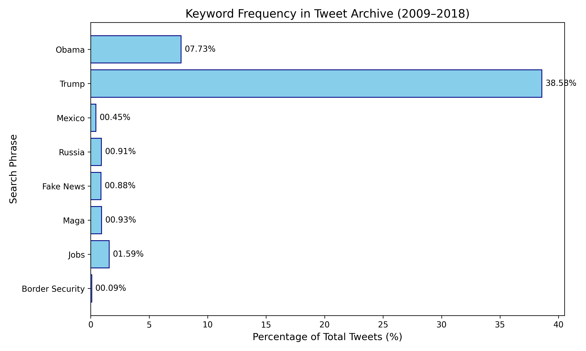

# [lab-web-data](https://csci40.rtealwitter.com/topics/05_web_scraping/lab.html)

Markdown Table Output
| phrase | percent of tweets |
| ----------------- | ----------------- |
|             obama |             07.73 |
|             trump |             38.58 |
|            mexico |             00.45 |
|            russia |             00.91 |
|         fake news |             00.88 |
|              maga |             00.93 |
|              jobs |             01.59 |
|   border security |             00.09 |

# Because phrases can share terms, the sum of percentages wont add up to 100

 

# Results show trump being the most used phrase as predicted with Obama coming next and jobs third!